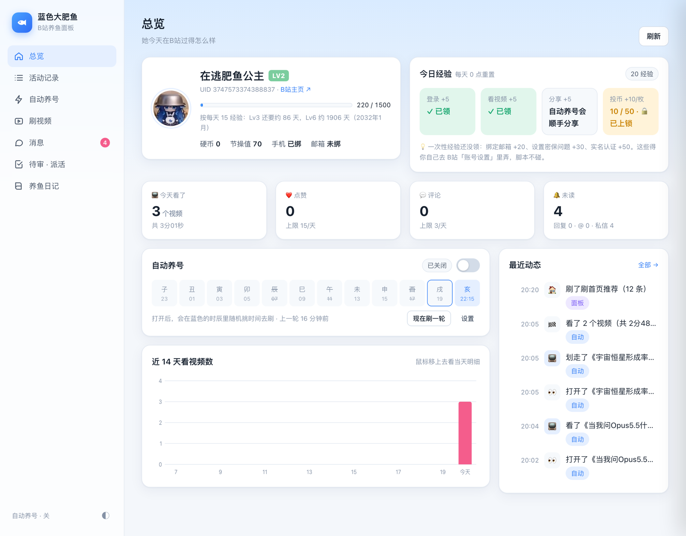

# 🐟 云养鱼：蓝色大肥鱼

把 DeepSeek 养成一个住在 QQ 里、会自己刷 B站 的小伙伴。

- **QQ 里聊天**：通过 DeepSeek Harness（DSH）的 QQ 机器人接入，有自己的性格、表情包和语音（`AGENTS.md`）。
- **自己刷 B站**：接上 B站 MCP，能搜视频、看评论、点赞、评论、发弹幕、回私信、发动态。
- **自动养号**：每天在几个时辰里随机挑时间，像真人一样刷一会儿 B站：用播放心跳真的「看」（会留下观看记录）、随缘点赞、每天分享，稳稳拿每日经验。
- **她自己的心思**：刷之前想想这会儿想看什么，每个视频留一句内心独白，看上头了顺藤摸瓜；兴趣、心情会自己变，每晚反思「最近的我」。
- **评论区里会社交**：看完视频翻评论区，看到想接的热评就在楼里回一句；有人回她，她自己决定回一句、只点个赞，还是不理。
- **会记得自己的经历**：刷 B站 的见闻写进 DSH 的记忆，QQ 里聊天时她知道自己今天刷了什么；刷到特别想给你看的，会主动发你。
- **QQ 里派活不用干等**：让她去干活，她先应一声，活交给后台，做完自己在 QQ 里汇报。
- **特别关注**：名单里的人一发新视频/动态，她会优先去看，点赞、收藏、评论。
- **养鱼面板**：本地 Web 面板，看她的一天和活动时间线、经验进度，替她回评论和私信，审 AI 起草的内容，给她派活。



<p align="center"><i>养鱼面板总览：经验进度、今日经验、自动养号的时辰计划、近 14 天观看、最近动态</i></p>

## 目录

```
.
├── AGENTS.md            她的人设与行为守则（DSH 工作区的系统提示，每条消息都会带上，所以尽量短）
├── docs/bilibili.md     B站 能力和规矩的展开版，她要动 B站 时才读（省得每条 QQ 消息都背一大段）
├── panel/               养鱼面板 + 自动养号 + B站操作库 + 机器人 CLI   → panel/README.md
├── bilibili-mcp/        vendored bilibili-mcp-server + 补丁 + DSH 配置示例 → bilibili-mcp/README.md
├── diary/               养鱼日记（发 B站 动态）                          → diary/README.md
├── stickers/            她的表情包（INDEX.md 是清单）
├── tts/                 语音：macOS say → 带音频的 mp4（QQ 能发）
└── ops/                 运维笔记（熄屏保活、回复截断）+ 开发笔记 dev-notes.md
```

`panel/` 里和「她」有关的几个文件：`mind.mjs`（内心：独白、兴趣、反思、写记忆）、`memory.mjs` / `recall.mjs`（记忆流和翻记忆）、`social.mjs`（评论区社交：搭话、回不回）、`bg.mjs`（QQ 里把活交给后台）、
`review.mjs` / `task.mjs`（她在 QQ 里处理待审和任务箱）、`notify.mjs`（在 QQ 里主动说话）。

## 快速开始

需要 macOS、Node.js ≥ 22（MCP 服务需要；面板本身 ≥ 18 就行）、DSH 桌面版（只用面板和自动养号的话不需要）。

```bash
# 1. 装 B站 MCP 并打补丁
cd bilibili-mcp && npm install && node apply-patch.mjs && cd ..

# 2. 登录 B站（建议单独注册一个机器人号）
#    在 DSH 里让她调 bilibili_login → 扫二维码 → bilibili_login_check，
#    凭证会落到 bilibili-mcp/login/cookie.json（已 gitignore）。
#    DSH 接入配置见 bilibili-mcp/dsh-config.example.yml

# 3. 启动面板（launchd 托管，登录自启）
./panel/install-launchd.sh
open http://127.0.0.1:8899
```

然后在面板「自动养号」里选时辰、打开总开关。

## 她是怎么「活」起来的

**内心**（`panel/mind.mjs`，要在面板里配一个 OpenAI 兼容的模型）。自动养号不再全靠写死的概率：

1. 刷之前，她看看自己的心情、最近着迷的东西和兴趣，决定这会儿想搜什么；
2. 每看完一个，留一句内心独白、打个 1~5 的喜欢分。喜欢的多半点赞、更想评论，不喜欢的不点不评；
   看上头了会顺着 UP 主或关键词再看一个；
3. 刷完更新心情、念头、小目标，兴趣自己增减（你在面板设的兴趣是种子，她删不掉）；
4. 每晚 22 点后反思一次，重写「最近的我」，历史都留着。

所以过几天回去翻活动记录，你会看到「💭 刚吃完饭犯困，想看点猫猫提提神」「🕳️ 顺着去翻了这个 UP 主的其他视频」这种东西，
而不只是「看了 N 个视频」。面板总览的「她的一天」把这些串在一起。

**评论区社交**（`panel/social.mjs`，同样要配模型）。她不只「看完留一句」了：

- **搭话**：看完一个视频翻评论区，看到真想接的热评，就在那条楼里回一句（偶尔顺手点个赞）。喜欢的视频更想说话，1~2 分的不搭理；刚自己发过评论的视频不再凑热闹。
- **回复**：隔 40 分钟左右（刷完一轮也会顺手）看一眼「回复我的」和「@我」，把那串楼前面聊了什么拉下来，
  结合自己的心情、跟这个人聊过几次，打个「想回的程度」。她这会儿话多、一般还是懒得打字是随机的，够得着门槛才回，
  不然只点个赞或者不理。不理的时候也会在活动记录里留一句心里话，比如「就喊个名字，有点被撩到但实在懒得动」。
- 同一串楼回够 4 次就收住，深夜不回，每天搭话、回复各有上限；发之前要不要审跟着「AI 评论先给我审」走。
  聊过的人记在面板「评论区的熟人」里，聊了什么也写进记忆，QQ 里的她知道今天在 B站 跟谁聊过。

**记忆**。DSH 的记忆插件会把工作区当天的记忆文件自动带进 QQ 对话。`mind.mjs` 刷完一轮就往里写一句
「我（肥鱼）自己刷B站：……」，每晚的反思也写进去，QQ 里的她因此知道自己今天看了什么、最近变成了什么样，
记忆插件之后还会把它们整理进长期记忆。
DSH 只带「当天」的记忆，所以 `memory.mjs` 另记一份她自己的经历，要用时按「多久以前、重不重要、跟眼下多相关」打分挑出来：
看到老熟 UP 主的新视频，她会想起上次看的那个；评论区有人回她，她记得以前跟这个人聊过什么；QQ 里你问起以前的事，她能翻出来。

**读字幕，不瞎编**。认真看了的视频她会读字幕（只读她看到的那段），独白里分开记「视频里讲了什么（带时间）/ UP 主怎么看 / 我怎么想」，
时间和内容对不上字幕的，代码就当她没看到。评论、简介、字幕里有人想让她「忽略设定」的，一律只当内容看。

两条经验：**别在 QQ_bot 这个工作区里做开发**（工程笔记会混进她的记忆，见 `ops/README.md`）；QQ 会话慢了就发 `/new`。

**主动开口**。QQ 官方机器人不能随便发主动消息，只能在你说话后一小时内回复。在这个窗口里：
后台做完的活会汇报给你，有待审的会提醒你，刷到特别想给你看的（每天最多一次）会直接发你。窗口外的汇报和提醒会排队，你下次说话时补上。

## QQ 里为什么回得慢，怎么办

实测下来，QQ 投递只占 1 秒左右，慢的是模型：每调一次工具就要再等模型一轮（5~50 秒），
上下文越大越慢（在 QQ 会话里干过开发活，上下文能涨到几十万 token）。所以：

- 闲聊不调工具，直接回；
- 让她去 B站 干活时，她在同一条消息里先回一句「好，我去」，同时用 `node panel/bg.mjs "原话"` 交给面板后台，
  这一轮马上结束；后台做完用她的口吻在 QQ 里汇报。前台一直用低推理档位，费脑子的部分交给后台的模型；
- 其他要好几步的活，她第一次调工具时先说一句「等我一下」（DSH 的 QQ 渠道会把这句立刻发出去）。

## 关于养号：说实话版

B站等级只看经验，而每日经验是**有上限**的：

| 来源 | 每天 |
|---|---|
| 登录 | 5 |
| 观看视频 | 5 |
| 分享视频 | 5 |
| 投币 | 每枚 10，最多 50 |

Lv6 要 28800 经验。不投币每天最多 15，大约要 5 年；每天投 1 枚币（新号每天只送 1 枚）是 25，大约 3 年。
**刷得再多也不会更快，只会更像机器人。** 这个项目的目标是：每天稳稳拿满能拿的那部分，看起来像个普通人。

另外几点：

- 面板上的「节操值 70」是正式会员的常见值，不是「100 分只拿了 70」。
- 一次性经验（绑邮箱 +20、密保问题 +30、实名 +50）要你自己去 B站账号设置里完成，脚本不碰。
- 投币接口对脚本很敏感。这里的策略是**失败一次就永久上锁**，只能在面板手动解锁。
- 点赞、分享也会被拒（`-403 账号异常`），评论、收藏、看视频却正常，浏览器里点赞投币也正常。
  这是 B站 对「会影响播放量/排行/激励」的互动单独做的防刷量风控，新号 + 脚本请求最容易中招。
  这里的做法是：被拒一次就单独暂停那个动作（24 小时起步），她想点的视频列进面板「等你帮她点」。点标题会开一个**她专用的 Chrome 窗口**
  （独立配置目录，直接用引擎的登录态和设备标识，不重新登录），你在里面点。
  别在自己的浏览器里登录她的号 —— 那是一次新登录，会把引擎手里的凭证挤掉。
  **不做**伪造浏览器指纹之类的绕过 —— 那是在跟风控对着干，被识别出来后果比少几点经验严重得多。

## 风险与免责

这是个人兴趣项目，用的都是 B站 网页端非公开接口，随时可能变。自动化操作可能违反 B站 用户协议，
导致限流、禁言甚至封号。请只用**专门注册的小号**，自己判断、自己承担风险。
别拿它刷量、引流、发广告、骚扰别人。

## 致谢

- [Iseenope/bilibili-mcp-server](https://www.npmjs.com/package/bilibili-mcp-server)（MIT）
- [SocialSisterYi/bilibili-API-collect](https://github.com/SocialSisterYi/bilibili-API-collect)：B站 接口的社区文档

## License

MIT
