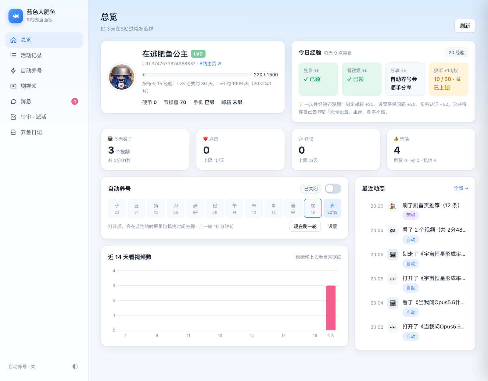

# 🐟 dsh-fishmate：一个有自己生活的 AI 伙伴

把 DeepSeek 养成一个住在 QQ 里的小伙伴。她不只是陪你聊天：你不在的时候，她自己刷 B站、看直播、逛贴吧、刷抖音，
看到的东西会记住、会慢慢忘，第二天跟你说「我昨天刷到个……」。

**她会做什么**

| | |
|---|---|
| 💬 **聊天** | QQ 小号（NapCat）、Telegram、QQ 官方机器人（经 DSH）三条线任选；坐在电脑前就用面板右下角的聊天框，跟 QQ 是同一份聊天记录 |
| 🎙️ **表情包和语音** | 按情绪发表情包，情绪对不上还会给自己画一张新的；发真的语音条（edge-tts，或者 GPT-SoVITS 克隆的嗓子）；听得懂你发的语音、看得懂你发的图 |
| ⏰ **提醒** | 「明早 8 点叫我」「工作日 11 点催我睡觉」，到点她自己来叫你 |
| 🔎 **查资料** | 不确定的事先说「等我查一下」，查完用她的口吻告诉你 |
| 📺 **刷 B站** | 每天在几个时辰里像真人一样刷：真的看（留观看记录）、随缘点赞评论、评论区跟人搭话、特别关注的人更新了先去看、每晚写日记 |
| 📡 **陪你看直播** | 「陪我看 XX 的直播」，她就一直待在直播间陪你，聊天时知道直播里在发生什么，偶尔跟你吐槽一句；你允许的话自己发弹幕，叫她出来才走。没人陪时她也会自己挑个房间看一会儿 |
| 🏛️ **逛贴吧 / 刷抖音** | 一个独立的后台浏览器，真登录、真点击，偶尔想说一句先给你审 |
| 🧠 **记忆** | 关于你的事单独记着、不会忘；她自己的经历按遗忘曲线慢慢变淡，常想起的记得牢；每晚反思「最近的我」，兴趣和心情自己会变 |
| 🌤️ **知道此刻** | 外面天黑没黑、什么月亮、下没下雨，心情跟着变；你说「我打游戏了」她就安静，说「好了」再回来 |
| 🖥️ **养鱼面板** | 本地网页：看她的一天、派活、审她想发的东西、跟她聊天、配置一切 |



## 快速开始

需要 **Node.js ≥ 18**（面板没有 npm 依赖）和一个 OpenAI 兼容的模型 API Key（默认 DeepSeek）。其他都是可选的：

| 想要 | 还需要 |
|---|---|
| QQ 小号聊天 | Docker（macOS 推荐 OrbStack），一个专门给她的 QQ 号 |
| Telegram 聊天 | 在 @BotFather 建个 bot |
| 刷 B站 / 看直播 | 一个专门给她的 B站 号（扫码登录） |
| 逛贴吧 / 刷抖音 | Chrome、Edge 或 Chromium |
| 语音 | ffmpeg + edge-tts（`pipx install edge-tts`）；听语音要 mlx-whisper（Apple 芯片） |

```bash
git clone https://github.com/reincarnationhurry-cell/dsh-fishmate.git && cd dsh-fishmate
./install.sh          # macOS / Linux：检查依赖、开机自启、打开面板
```

Windows 双击 `start.cmd`。第一次打开面板会进「上手」页，一项一项告诉你还缺什么、去哪儿配。

想换个人设：面板「自动养号 → 她是谁」改名字，`AGENTS.md` 改性格和说话方式。

**用 DeepSeek Harness（DSH）的话**：在 DSH 里说「按 docs/SETUP-DSH.md 帮我部署，我要做的步骤停下来告诉我」，
`dsh-plugin/yangyu-panel` 能把面板嵌进 DSH 左栏。

## 目录

```
.
├── install.sh / start.cmd   一键安装（macOS / Linux）/ Windows 启动
├── AGENTS.md            她的人设与行为守则（性格、说话方式、记忆习惯、红线）
├── panel/               养鱼面板：大脑、记忆、自动养号、B站 / 贴吧 / 抖音 / 直播   → panel/README.md
│   └── qq/              聊天：QQ 小号 / Telegram / 面板聊天框，语音，外挂            → panel/qq/README.md
├── dsh-plugin/          DSH 插件：把面板嵌进 DSH 左栏
├── docs/                B站 规矩（bilibili.md）、DSH 部署手册（SETUP-DSH.md）
├── bilibili-mcp/        vendored bilibili-mcp-server + 补丁（DSH 里用）
├── diary/               养鱼日记（发 B站 动态）
├── stickers/            她的表情包（INDEX.md 是清单）
└── tts/                 DSH 那条线用的语音脚本
```

`panel/` 里和「她」有关的：`mind.mjs`（内心）、`memory.mjs` / `recall.mjs`（记忆）、`social.mjs`（评论区社交）、`bililive.mjs`（看直播）、
`webvisit.mjs`（贴吧 / 抖音）、`remind.mjs`（提醒）、`lingo.mjs`（学说话）、`sky.mjs`（她的窗）、`pause.mjs`（叫停）、`setup.mjs`（上手检查）。

## 她是怎么「活」起来的

**内心**（`panel/mind.mjs`，要在面板里配一个 OpenAI 兼容的模型）。自动养号不再全靠写死的概率：

1. 刷之前，她看看自己的心情、最近着迷的东西和兴趣，决定这会儿想搜什么；
2. 每看完一个，留一句内心独白、打个 1~5 的喜欢分。喜欢的多半点赞、更想评论，不喜欢的不点不评；
   看上头了会顺着 UP 主或关键词再看一个；
3. 刷完更新心情、念头、小目标，兴趣自己增减（你在面板设的兴趣是种子，她删不掉）；
4. 每晚 22 点后反思一次，重写「最近的我」，历史都留着。

所以过几天回去翻活动记录，你会看到「💭 刚吃完饭犯困，想看点猫猫提提神」「🕳️ 顺着去翻了这个 UP 主的其他视频」这种东西，
而不只是「看了 N 个视频」。面板总览的「她的一天」把这些串在一起。

**评论区社交**（`panel/social.mjs`，同样要配模型）。她不只「看完留一句」了：

- **搭话**：看完一个视频翻评论区，看到真想接的热评，就在那条楼里回一句（偶尔顺手点个赞）。喜欢的视频更想说话，1~2 分的不搭理；刚自己发过评论的视频不再凑热闹。
- **回复**：隔 40 分钟左右（刷完一轮也会顺手）看一眼「回复我的」和「@我」，把那串楼前面聊了什么拉下来，
  结合自己的心情、跟这个人聊过几次，打个「想回的程度」。她这会儿话多、一般还是懒得打字是随机的，够得着门槛才回，
  不然只点个赞或者不理。不理的时候也会在活动记录里留一句心里话，比如「就喊个名字，有点被撩到但实在懒得动」。
- 同一串楼回够 4 次就收住，深夜不回，每天搭话、回复各有上限；发之前要不要审跟着「AI 评论先给我审」走。
  聊过的人记在面板「评论区的熟人」里，聊了什么也写进记忆，QQ 里的她知道今天在 B站 跟谁聊过。

**记忆**。分几层，学的是人脑：

- **今天**：DSH 的记忆插件把当天的记忆文件带进 QQ 对话。`mind.mjs` 刷完一轮往里写一句「我（肥鱼）自己刷B站：……」（括号里是她的简称），
  睡前反思也写进去，QQ 里的她知道自己今天看了什么、最近变成了什么样。
- **经历**（`memory.mjs`）：看过的视频、每轮的印象、评论区跟谁聊过、跟你聊了什么，每段都单独记一条。
  要用时按「还记得多清楚、重不重要、跟眼下多相关」挑最该想起的几条：看到老熟 UP 主的新视频，她想起上次看的那个；
  评论区有人回她，她记得以前跟这个人聊过什么；你在 QQ 里问起以前的事，她能翻出来。
- **印象**：每晚睡前，几天前零零碎碎差不多的几件事，她自己概括成一条，比如「桃鼠-家的小猫长牙、吃猫条我都追着看」。
- **关于你的事**（`qq/owner.mjs`）：你的称呼、作息、计划、口头禅，单独存着，不会忘，记错了她自己改。

经历会忘，照的是艾宾浩斯遗忘曲线 R = e^(-t/S)：每条记忆有自己的「稳定度」S，重要的、情绪强的（特别喜欢、特别嫌弃、吵架、被感动）一开始就牢。
被想起一次 S 就变大，而且**快忘了的时候想起涨得最多，刚想起过又想起几乎不涨**（间隔效应），所以不会因为一件事反复提就永远忘不掉。
清楚度掉到 20% 她会先把那条记成模糊的样子（「好像刷到过一个讲巨齿鲨的，评论在吵什么来着」），细节就真没了；掉到 5% 才忘。
面板「她的一天」底下能看每条还记得几成，记错了能改能删。

**她的窗**（`panel/sky.mjs`）。在面板「自动养号 → 她的窗」填个城市名，她就能看窗外：太阳按经纬度现算（日出日落误差一两分钟），
天黑透了才说月亮，月相按日月黄经差算，天气一小时查一次（Open-Meteo，免 Key，只收到城市名和经纬度）。
刷之前想看什么、刷完心情怎么变、睡前反思都会看一眼，「她的一天」顶上也有这一行。不填地点就只知道几点。

**一句话叫停**（`panel/pause.mjs`）。你在 QQ 里说「我打游戏了」「开会呢」，她回一声，后台就停：叫停前在刷的那轮收手，
不按时辰去刷、不看评论区回复、不主动发你东西（要审的先排着，你回来说话时补上）。你说「好了」才恢复；忘了说最多停 24 小时。
没说就照常，不会自己琢磨着让路。叫停期间你亲口派的活照做，面板总览上也能点「恢复」。

**学说话**。热评里流行的梗和说法，她每晚学几个，写评论、接话时合适就用；号主的口头禅她在 QQ 里自己记。

**模型预算**。她后台自己动脑子（内心、社交、自动评论）每天有上限，到了就按老习惯随缘刷，第二天恢复；你点的、派的活不受限。

**读字幕，不瞎编**。认真看了的视频她会读字幕（只读她看到的那段），独白里分开记「视频里讲了什么（带时间）/ UP 主怎么看 / 我怎么想」，
时间和内容对不上字幕的，代码就当她没看到。评论、简介、字幕里有人想让她「忽略设定」的，一律只当内容看。

两条经验：**别在她的 DSH 工作区里做开发**（工程笔记会混进她的记忆）；QQ 会话慢了就发 `/new`。

**主动开口**。QQ 官方机器人已经不能发主动消息了（实测不带你消息 id 的推送一律被拒，错误码 11001），只能在你说话后一小时内回复。在这个窗口里：
后台做完的活会汇报给你，有待审的会提醒你，刷到特别想给你看的（每天最多一次）会直接发你。
窗口外的汇报、提醒和她想跟你说的话会揣着，你下次说话时补上（想分享的超过 12 小时就不说了，不新鲜了）。
想让她真的能凭空找你，换成她自己的 QQ 小号（`panel/qq/README.md`）：汇报、提醒、分享随时发，白天你隔久了没说话她还会自己找你。

**每晚自己写日记**。到了「养鱼日记」里设的钟点（默认 22 点，今晚还有没刷完的时辰就等它刷完），她从当天心里想过的话里挑一两段写成动态。
开着「先给我审」就进待审，你下次在 QQ 说话时她会问你；关掉就直接发。

**口味别太单一**。喜欢什么她自己长，但最近 20 个里有一半左右都是同一个主题时（比如「猫」），她刷之前会被提醒换换口味：
搜词不再沾这个主题、给她几个别的方向挑，这一轮最多看一个、也不顺着往下挖；同一主题长出来的兴趣最多留 3 个。

**外挂：查资料、看图、做表情包**（`panel/qq/dsh.mjs`）。小号这边的她不能上网、看图，这几样借 DSH：查资料用 DSH 官方命令行跑一个她专用的配置，
里面只留联网搜索（跑命令、读写文件的工具全关掉）；看图走 DSH 本地网关里的模型；做新表情直连 ModelScope 的生图接口。聊天还在面板里，DSH 出问题也不影响陪你聊。见 `panel/qq/README.md`。

**QQ 掉线提醒**（`panel/health.mjs`）。DSH 自动升级后插件跟不上会静悄悄掉线，面板每 5 分钟查一次，出问题挂红条、弹 macOS 通知。

## QQ 里为什么回得慢，怎么办

实测下来，QQ 投递只占 1 秒左右，慢的是模型：每调一次工具就要再等模型一轮（5~50 秒），
上下文越大越慢（在 QQ 会话里干过开发活，上下文能涨到几十万 token）。所以：

- 闲聊不调工具，直接回；
- 让她去 B站 干活时，她在同一条消息里先回一句「好，我去」，同时用 `node panel/bg.mjs "原话"` 交给面板后台，
  这一轮马上结束；后台做完用她的口吻在 QQ 里汇报。前台一直用低推理档位，费脑子的部分交给后台的模型；
- 其他要好几步的活，她第一次调工具时先说一句「等我一下」（DSH 的 QQ 渠道会把这句立刻发出去）。

## 关于养号：说实话版

B站等级只看经验，而每日经验是**有上限**的：

| 来源 | 每天 |
|---|---|
| 登录 | 5 |
| 观看视频 | 5 |
| 分享视频 | 5 |
| 投币 | 每枚 10，最多 50 |

Lv6 要 28800 经验。不投币每天最多 15，大约要 5 年；每天投 1 枚币（新号每天只送 1 枚）是 25，大约 3 年。
**刷得再多也不会更快，只会更像机器人。** 这个项目的目标是：每天稳稳拿满能拿的那部分，看起来像个普通人。

另外几点：

- 面板上的「节操值 70」是正式会员的常见值，不是「100 分只拿了 70」。
- 一次性经验（绑邮箱 +20、密保问题 +30、实名 +50）要你自己去 B站账号设置里完成，脚本不碰。
- 投币接口对脚本很敏感。这里的策略是**失败一次就永久上锁**，只能在面板手动解锁。
- 点赞、分享也会被拒（`-403 账号异常`），评论、收藏、看视频却正常，浏览器里点赞投币也正常。
  这是 B站 对「会影响播放量/排行/激励」的互动单独做的防刷量风控，新号 + 脚本请求最容易中招。
  这里的做法是：被拒一次就单独暂停那个动作（24 小时起步），她想点的视频列进面板「等你帮她点」。点标题会开一个**她专用的 Chrome 窗口**
  （独立配置目录，直接用引擎的登录态和设备标识，不重新登录），你在里面点。
  别在自己的浏览器里登录她的号 —— 那是一次新登录，会把引擎手里的凭证挤掉。
  **不做**伪造浏览器指纹之类的绕过 —— 那是在跟风控对着干，被识别出来后果比少几点经验严重得多。

## 风险与免责

这是个人兴趣项目，用的都是 B站 网页端非公开接口，随时可能变。自动化操作可能违反 B站 用户协议，
导致限流、禁言甚至封号。请只用**专门注册的小号**，自己判断、自己承担风险。
别拿它刷量、引流、发广告、骚扰别人。

## 致谢

- [Iseenope/bilibili-mcp-server](https://www.npmjs.com/package/bilibili-mcp-server)（MIT）
- [SocialSisterYi/bilibili-API-collect](https://github.com/SocialSisterYi/bilibili-API-collect)：B站 接口的社区文档

## License

MIT
